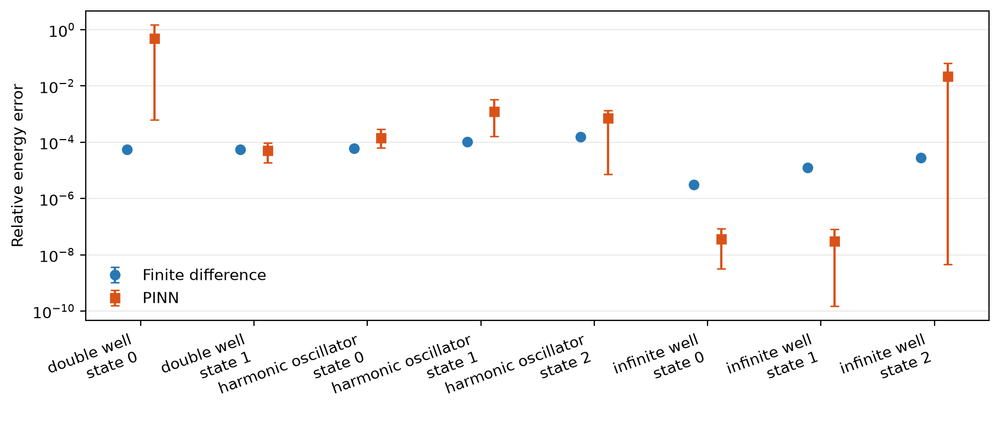
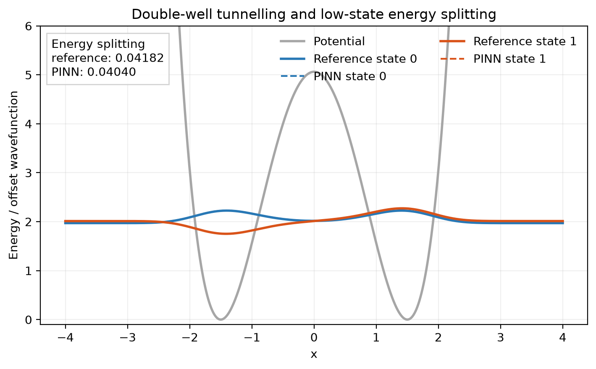
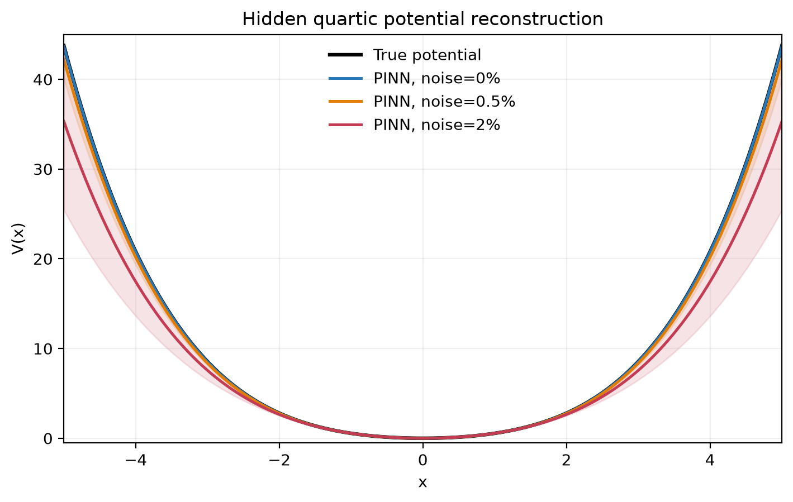
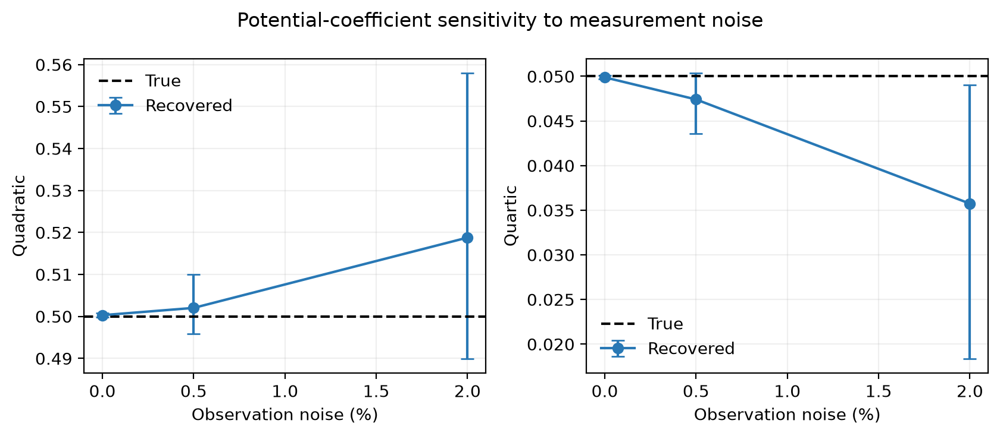

# QuantumPINN

QuantumPINN is a compact scientific machine-learning project for the one-dimensional,
time-independent Schrödinger equation

\[
-\frac{\hbar^2}{2m}\frac{d^2\psi}{dx^2} + V(x)\psi = E\psi.
\]

The project asks two questions:

1. How accurately can a physics-informed neural network (PINN) recover low-lying
   eigenstates compared with analytical and finite-difference solutions?
2. When the potential is unknown, what information is needed to reconstruct it
   reliably from measured energies and probability densities?

The intended result is a reproducible comparison, not a claim that PINNs outperform
standard eigensolvers on simple forward problems. See [PROJECT_SCOPE.md](PROJECT_SCOPE.md)
for the scientific scope, acceptance criteria, and delivery plan.

## Current status

The numerical benchmark and forward-PINN layers are implemented:

- dimensionless quantum units by default (`hbar = m = 1`);
- reusable harmonic, infinite-well, finite-well, barrier, quartic, and double-well
  potentials;
- a finite-difference Dirichlet eigensolver;
- analytical infinite-well and harmonic-oscillator reference states;
- sign-invariant wavefunction and energy error metrics;
- forward-solver tests and a benchmark script;
- a smooth PyTorch wavefunction network with a trainable energy;
- exact finite-domain Dirichlet boundary conditions;
- Schrödinger residual, normalisation, and excited-state orthogonality losses;
- grid-normalised physics residuals that prevent collapse to the trivial zero state;
- differentiable state deflation that prevents excited states collapsing to lower modes;
- deterministic Adam plus L-BFGS training and a forward-PINN experiment script.

The forward evaluation and parametric inverse-potential suites are also implemented,
including three-seed comparisons, machine-readable result tables, and figures. PyTorch
remains optional so the numerical reference solver can be used without installing the
ML stack.

## Quick start

Python 3.10 or newer is recommended.

```bash
python -m pip install -e .
python experiments/benchmark_forward.py
python -m unittest discover -s tests -v
```

For later PINN development:

```bash
python -m pip install -e '.[ml,dev]'
```

Train a ground-state PINN after installing the ML extra:

```bash
python experiments/train_forward_pinn.py --system well --state 0
python experiments/train_forward_pinn.py --system oscillator --state 0
```

Run the complete forward comparison across three seeds:

```bash
python -m pip install -e '.[ml,plot]'
python experiments/evaluate_forward.py --seeds 0 1 2
```

## Forward benchmark results

The finite-difference solver is consistently accurate and much faster for these simple
forward problems. Successful PINN runs reach very small errors for the square well and
sub-percent errors for the oscillator and double well, but the three-seed study also
shows optimiser sensitivity. In particular, one double-well ground-state run converged
to the next even eigenstate, and one second-excited square-well run was less accurate.
Those failures remain in the aggregate tables rather than being discarded.

For representative seed 0, the double-well reference splitting is `0.04182` and the
PINN splitting is `0.04040`. Full per-run, aggregate, and tunnelling tables are in
[`results/forward`](results/forward).





Additional state-by-state figures:

- [infinite square well](figures/infinite_well_states.png)
- [harmonic oscillator](figures/harmonic_oscillator_states.png)
- [symmetric double well](figures/double_well_states.png)

## Inverse-potential results

The inverse experiment hides the coefficients of
`V(x) = 0.5*x**2 + 0.05*x**4`, fixes the energy gauge with `V(0) = 0`, and reconstructs
the potential from 25 sparse signed-wavefunction samples and the absolute energy of each
of the first two states. It repeats the fit across three seeds at 0%, 0.5%, and 2%
synthetic observation noise.

Median held-out potential errors are approximately `7.0e-4`, `1.6e-2`, and `8.9e-2`,
respectively. The increasing seed spread at 2% noise illustrates the inverse problem's
sensitivity to imperfect measurements. Per-run and aggregate tables are in
[`results/inverse`](results/inverse).

```bash
python experiments/inverse_potential.py
```





## Repository layout

```text
src/quantumpinn/       numerical, PINN, training, and evaluation code
experiments/           reproducible experiment entry points
tests/                 numerical and scientific regression tests
figures/               generated benchmark plots
results/               per-run and aggregate benchmark tables
PROJECT_SCOPE.md       scope, milestones, and success criteria
```

## Conventions

Unless an experiment states otherwise, all quantities are dimensionless with
`hbar = m = 1`. Wavefunctions are normalised on the finite computational domain.
For analytical comparisons, their arbitrary global sign is aligned before computing
the error.
